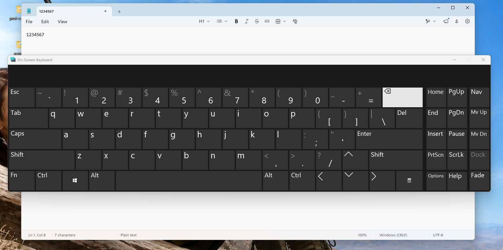
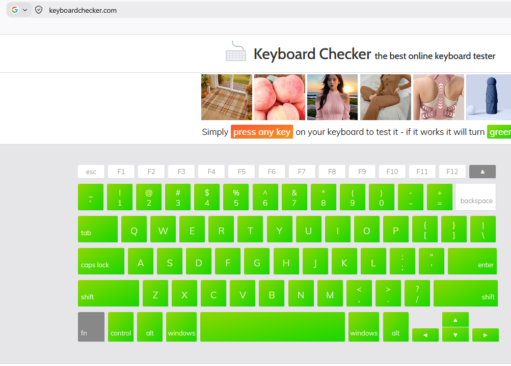

# Guide: Troubleshooting a Single Keyboard Key Not Responding in Windows

## Purpose

This guide provides a repeatable Service Desk workflow for Windows incidents where one physical keyboard key stops responding while the rest of the keyboard remains usable.

The screenshots in this guide come from a resolved Royal Kludge RK L75 incident in which the physical **Backspace** key stopped responding. The troubleshooting logic is reusable for other single-key failures, but hardware-specific remediation should only be used after the problem has been isolated to the keyboard or key itself.

---

## Scope

Use this guide when:

* One physical keyboard key does not perform its expected action.
* Other keys continue to work normally.
* You need to determine whether the fault is application-specific, Windows-related, connection-related, driver-related, or physical to the keyboard.
* The issue can be reproduced consistently enough to test.

Avoid immediately reinstalling drivers, resetting keyboard firmware, removing keycaps, or replacing switches. First establish whether Windows can process the expected input and whether the physical keypress is being detected.

---

## Step 1 - Reproduce and Record the Failure

Open a simple text-entry application such as Notepad and reproduce the issue.

For a Backspace problem:

1. Type several characters.
2. Press the physical Backspace key.
3. Confirm whether characters are removed.
4. Repeat the test to rule out a single missed keypress.
5. Record whether other nearby keys continue to respond.

In the example incident, characters remained in the text field when the physical Backspace key was pressed.

If the problem cannot be reproduced, gather more information about when it occurs before changing the system.

---

## Step 2 - Confirm Windows Can Process the Expected Key Function

Test the same function without using the physical key.

For common Windows keyboard troubleshooting, the **On-Screen Keyboard** is useful because it sends the key function through Windows without relying on the physical keyboard switch.

Open it with:

**Windows + Ctrl + O**

Then select the affected key using the On-Screen Keyboard.

Interpret the result:

* If the On-Screen Keyboard performs the expected action, Windows and the active application can process that key function. Continue isolating the physical keyboard path.
* If the On-Screen Keyboard also fails, test another application and investigate Windows/application behavior before assuming a physical keyboard fault.

In the example incident, Backspace worked through the Windows On-Screen Keyboard.

---

## Step 3 - Test Whether Windows Detects the Physical Keypress

Use a keyboard input tester to determine whether the physical keypress is reaching the operating system/browser input layer.

1. Open a keyboard-testing utility or trusted keyboard tester.
2. Press several known-working keys to confirm the tester is receiving input.
3. Press the affected physical key several times.
4. Compare its response with the working keys.

In the example incident, other keys registered normally but the physical Backspace key did not.

This combination is important:

* Software/On-Screen Backspace works.
* Physical Backspace is not detected.

That evidence shifts troubleshooting away from the text application and toward the physical keyboard, connection, HID device state, firmware, or key hardware.

---

## Step 4 - Reset the Keyboard Connection

Before changing drivers or firmware, perform a simple non-destructive connection reset.

For a wired USB keyboard:

1. Disconnect the keyboard from the computer.
2. Wait approximately 10–15 seconds.
3. Reconnect the keyboard.
4. Allow Windows to recognize the device.
5. Retest the affected key in the original application.
6. Retest with the keyboard tester if needed.

For a wireless keyboard, use the equivalent connection reset appropriate to the device, such as reconnecting the receiver or re-establishing the supported wireless connection.

In the example incident, disconnecting and reconnecting the Royal Kludge keyboard restored normal Backspace operation.

---

## Step 5 - Test Another Port or Connection Path if the Issue Persists

If reconnecting the keyboard does not resolve the issue:

1. Move a wired USB keyboard to another known-good USB port.
2. Avoid an unpowered hub during testing when possible.
3. If the keyboard supports more than one connection mode, test another supported mode only if it is practical and permitted.
4. Retest the same affected key.

If the problem changes with the port or connection path, investigate the original USB port, hub, receiver, cable, or connection method rather than the key switch itself.

---

## Step 6 - Compare With Another Keyboard or Endpoint

Use substitution testing to determine whether the fault follows the keyboard.

Where equipment is available:

1. Connect another known-good keyboard to the affected Windows endpoint and test the same key function.
2. Connect the affected keyboard to another endpoint and test the affected physical key.

Interpret the results:

* If another keyboard works on the original endpoint while the affected keyboard fails on multiple endpoints, the problem is likely local to the keyboard.
* If multiple keyboards show the same behavior on one endpoint, continue investigating Windows, drivers, accessibility settings, remapping software, or endpoint configuration.

---

## Step 7 - Review Windows Keyboard/HID State if the Failure Continues

If the issue remains unresolved after connection and substitution testing, review the Windows device layer.

Check:

1. **Device Manager** for keyboard or HID devices showing warnings or errors.
2. Whether the keyboard disconnects/reconnects unexpectedly.
3. Whether vendor keyboard software, remapping utilities, macros, or profiles affect the key.
4. Windows accessibility features or keyboard settings that could alter expected input behavior.
5. Available vendor-supported firmware or software updates, if relevant to the device and approved for the environment.

Avoid removing a working driver or resetting firmware unless the evidence supports that layer and an appropriate recovery path is available.

---

## Step 8 - Evaluate the Physical Key Only After Software and Connection Isolation

If the affected key is not detected across multiple endpoints and connection resets do not help, the problem may be physical to the keyboard.

Depending on the keyboard design and support policy, next actions may include:

* Inspecting for debris or obstruction around the affected key.
* Following manufacturer-approved cleaning procedures.
* Testing or replacing a hot-swappable switch where supported.
* Replacing the keyboard if repair is not practical or permitted.
* Escalating to warranty/vendor support.

Do not disassemble employer-owned equipment or remove switches unless the support procedure, warranty terms, and authorization allow it.

---

## Step 9 - Verify Before Closing the Incident

Do not close the incident merely because the keyboard reconnects successfully.

Verify that:

1. The same physical key that originally failed now responds.
2. The expected action works in the original application.
3. A keyboard tester detects the physical key when appropriate.
4. Other keyboard functions still operate normally.
5. The user confirms normal operation is restored.

For the example incident:

> Disconnected the Royal Kludge keyboard, waited approximately 10–15 seconds, reconnected it, allowed Windows to recognize the device, and confirmed that the physical Backspace key resumed normal operation.

---

## Escalation Criteria

Escalate or continue deeper troubleshooting if:

* The affected key is not detected after reconnecting the keyboard.
* The issue follows the keyboard to another endpoint.
* Multiple keys fail or the keyboard repeatedly disconnects.
* Device Manager reports persistent HID/keyboard errors.
* Vendor firmware or configuration changes require elevated permissions or change approval.
* A physical switch, PCB, cable, receiver, or keyboard hardware fault is suspected.
* The device is under warranty or hardware repair is outside Service Desk scope.

---

## Documentation Checklist

When recording the ticket or runbook, include:

* Affected keyboard and connection type.
* Exact key or keys affected.
* Application used to reproduce the issue.
* Whether Windows On-Screen Keyboard performs the expected function.
* Whether a keyboard tester detects the physical keypress.
* Connection reset or alternate-port results.
* Substitution-test results if performed.
* Exact remediation that restored service.
* Final user confirmation.

This sequence documents what was tested, what was ruled out, and why the next troubleshooting action is appropriate.
